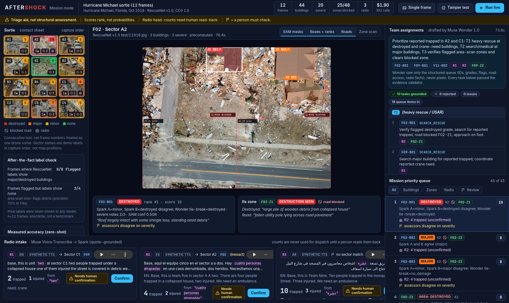

# Aftershock

**Live demo:** _link added at deployment_ · **Code:** https://github.com/GeekLord/aftershock · **Licence:** MIT (code only)

**Find the worst first, with evidence.** Aftershock turns a post-disaster drone sortie and multilingual radio calls into **one mission-level priority queue** and a **draft team plan**, and it says plainly when a person needs to check.



**Meta models at the core.** Built for the Meta Global AI Developer Hackathon (2026), with every perception, reasoning and speech step running on Meta's models:
- **SAM 3.1** segments buildings in every frame (masks shown on the map).
- **Muse Spark 1.3** grades each building twice with two independent frozen prompts (A and B), and scans every zone for destroyed structures, blocked roads and floodwater.
- **Muse Wonder 1.0** does two jobs: breaks ties when Spark A and B disagree on severity, and acts as the **incident-commander planner**. It sees only structured tool outputs (IDs, grades, flags, road access, radio facts), never pixels, and every claim it makes must cite evidence IDs that a validator checks.
- **Muse Voice Transcribe** turns radio calls (25 languages) into text; Spark extracts head-counts *with the exact source words*, so a person can read them back.

## What was built during the hackathon
1. **Survey pipeline** (`aftershock/pipeline.py`): tiling, SAM merge, two-prompt grading, disagreement flag, Wonder tie-break, area scans. Prompts are frozen and validated (`aftershock/prompts.py`, `docs/RESULTS.md`).
2. **Mission mode** (`aftershock/mission.py`):
   - Surveys every frame of a sortie, then builds **one priority queue across frames**. Every building has a stable ID (`F03-B04` = frame 3, building 4), every zone too (`F03-Z2`), and every radio call (`R1`). Each item carries its grade, how the graders agreed, review flags and road-access evidence.
   - Scores are a transparent integer (destroyed 6, major 4, area-scan destruction 5, +1 if the zone scan corroborates, +3 for an unconfirmed trapped-people radio report in the same sector, +5 once a person confirms it). They rank; they are not probabilities.
   - **Radio fusion**: calls become cards in the same queue. If the location names a sector ("Sector C1", or ASR-mangled "sector a a dos") the card attaches to that frame and raises its items' priority. Counts always show their source quote and "needs human confirmation" until someone presses Confirm.
   - **Incident commander**: Muse Wonder drafts assignments for three teams (heavy rescue, search + medical, route clearance). A validator rejects any task that cites an ID that does not exist, claims people without a radio ID, states a count that does not match the cited report, claims collapse without an item graded major/destroyed, claims a road problem without a zone, or double-assigns a target. If no task survives, a rule-based fallback plan is used and labelled as such.
   - **Tamper test** button: injects made-up tasks into Wonder's plan and shows the validator rejecting them (no model call).
3. **Precomputed demo mission** (`missions/michael-sortie/mission.json`) so the demo is instant, plus **Run live**: re-surveys the selected frame and re-plans with Wonder, streaming every model call (SAM, Spark scan, Spark A, Spark B, Wonder) with latency, tokens and cost over Server-Sent Events.
4. **Operations-console UI** (`web/index.html`, vanilla JS, no build step): sortie contact sheet with heat colouring, frame viewer with SAM-mask / box / road / zone toggles, team plan and queue with evidence links that jump to the frame and building, radio strip with transcript, quote, count and Confirm, a persistent honesty banner, and a measured-accuracy panel. The layout also works on a phone-sized screen. The single-frame view (upload one drone image, video or radio call) is at `/classic.html`, linked from the console as **Single frame**.
5. **Call ledger** (`aftershock/meta.py`): every model call is counted and priced at list rates; a per-process budget cap (`AFTERSHOCK_BUDGET_USD`, default 5) stops calls when reached.

## Why it is built this way
Every design choice comes from a measured result (full details in [docs/RESULTS.md](docs/RESULTS.md)):

| Finding | Design response |
|---|---|
| Exact 4-grade accuracy is 66%, but 95.5% of grades land within one level and severe-damage recall is 90% (n=200) | Rank by severe damage; never claim certified grades |
| Error is 15% when independent assessors agree, 43% when they disagree | Disagreement raises a ⚑ human-review flag |
| The model's own "needs review" flag fired 0/60 times | Review flags come from code, not self-report |
| SAM finds 96% of flooded intact buildings but misses flattened ones (3/13) | Zone scans look for destruction; zone-only detections become their own queue items |
| A planner model that wrote its own vision prompts over-flagged debris | Wonder plans only over structured outputs; perception prompts stay frozen |
| A lost full stop turned "team nine. ten people" into "nineteen" | Counts carry their source quote and must be read back |

## Run it
Needs Python 3.10+ and **ffmpeg + ffprobe** on `PATH`. ffprobe/ffmpeg extract frames from uploaded videos in the single-frame view; ffmpeg also normalises uploaded radio audio and builds the demo radio calls. The precomputed demo mission does not need them.
```bash
python -m venv .venv && . .venv/bin/activate
pip install -r requirements.txt
export MODEL_API_KEY=...          # Meta Model API key (only needed for Run live / uploads)
uvicorn server:app --port 8000    # open http://localhost:8000  (single-frame view: /classic.html)
```
The precomputed mission loads without a key. To rebuild it (about $2 of API calls at list prices):
```bash
export RESCUENET_DIR=./data/rescuenet   # default; see below
python tools/build_mission.py manifest
python tools/build_mission.py frame F01 F02 F03 F04 F05 F06 F07 F08 F09 F10 F11 F12
python tools/build_mission.py radio
python tools/build_mission.py assemble
```
`RESCUENET_DIR` is the folder holding the RescueNet v1.0 test images and pixel labels, flat, named `RescueNet__test__test-org-img__<n>.jpg` and `RescueNet__test__test-label-img__<n>_lab.png`. It defaults to `data/rescuenet` inside the repo (`data/` is git-ignored); download the test split from the figshare collection below. Other build settings: `MISSION` (default `michael-sortie`), `AFTERSHOCK_BUDGET_USD` (default 5).

### Deploy (Docker)
The `Dockerfile` runs the console on port `8080` (override with `PORT`). The precomputed mission works with no key. With `MODEL_API_KEY` set, Run live and uploads make paid Meta API calls; the image defaults to `AFTERSHOCK_BUDGET_USD=3` and `AFTERSHOCK_MAX_LIVE=3` per process. Live runs keep state in memory, so run a **single instance**. For a public link, set `AFTERSHOCK_SPEND_FILE` to a path on persistent storage (for example a Cloud Storage bucket mounted as a volume) so the spend cap and live-run count survive restarts and scale-to-zero, and `AFTERSHOCK_IP_COOLDOWN_S` to limit how often one visitor can start a live run. When a cap is reached the console says so and the cached mission keeps working. Without the RescueNet originals in the image, Run live re-surveys the committed 1600 px frame.
```bash
docker build -t aftershock . && docker run -p 8080:8080 aftershock
```

Offline tests (no API key, no network): `python tests/test_mission.py`. pytest is not in `requirements.txt`; if you prefer it, `pip install pytest` and run `python -m pytest -q tests`.

API: `GET /api/mission`, `POST /api/radio/{id}/confirm`, `POST /api/live {fid, replan_only}`, `GET /api/live/{job}/events` (SSE), `POST /api/validate {plan}`, `GET /api/cost`, plus the original `/api/survey` and `/api/voice`.

## Layout
- `aftershock/meta.py`: Meta Model API clients (chat, SAM, ASR) and the call ledger
- `aftershock/prompts.py`: frozen, validated prompts, each with its validation result
- `aftershock/pipeline.py`: per-frame survey engine
- `aftershock/mission.py`: mission queue, radio fusion, Wonder commander and plan validator
- `aftershock/voice.py`: radio-call intake with quote-grounded extraction
- `tools/build_mission.py`: precomputes the demo mission
- `missions/michael-sortie/`: cached demo mission (frames, masks, synthetic radio audio with `radio/LABEL.md`, `mission.json`)
- `server.py`, `web/`: API and UI (`web/index.html` mission console, `web/classic.html` single-frame view)
- `eval/`, `tests/`: evaluation scripts behind every number, and offline tests
- `docs/`: results, mission-mode notes, screenshots

## Data and audio licences
- **RescueNet v1.0** (Hurricane Michael, 2018): Rahnemoonfar, Chowdhury, Murphy, *RescueNet: a high resolution UAV semantic segmentation dataset for natural disaster damage assessment*, Scientific Data 10, 913 (2023). Figshare collection 6647354, https://doi.org/10.6084/m9.figshare.c.6647354, **CC0 1.0**. The CC BY-NC-ND notice in the RescueNet GitHub README does not apply to this figshare release, which is the copy used here. The demo mission uses 12 test-set frames (11914, 11916, 11918, 11924, 11939, 11943, 11946, 11955, 11959, 11961, 11965, 11979), resized. Their pixel labels are used only for an after-the-fact check and are never shown to a model.
- **FloodNet** (Hurricane Harvey): Rahnemoonfar et al., IEEE Access 2021, BinaLab, **CDLA-Permissive-1.0**. Used in evaluation and one sample.
- **Radio calls are synthetic.** Every radio call in this repo is text-to-speech generated from scripted, fictional text, then degraded to radio quality. None is a real emergency call, and the people, units and incidents in them are invented. They are labelled synthetic in the UI.
  - R1 (English) and `samples/radio_english.wav`: generated with Sarvam Bulbul v3 (Sarvam AI), labelled as AI-generated per Sarvam's Terms of Service §10.2.
  - R2 (Spanish) and R3 (Arabic, also `samples/radio_arabic.wav`): generated with ElevenLabs (eleven_multilingual_v2) on the free plan, for non-commercial use, with credit to elevenlabs.io.
  - Generation scripts are in `tools/synth/`.
  - The audio files (`missions/*/radio/*.wav`, `samples/*.wav`) are **not covered by the MIT licence**; they remain under their TTS providers' terms. See `missions/michael-sortie/radio/LABEL.md`.

## Licence
Code: MIT (see `LICENSE`). Datasets and synthetic audio keep their own terms, listed above.

## Limitations
Aftershock is a triage aid. It is not a structural assessment and does not make rescue decisions. Numbers below are from [docs/RESULTS.md](docs/RESULTS.md); results are zero-shot on public datasets the models may have seen in training.
- **Scores rank; they are not probabilities.** The priority score is an integer sum of rules. Spark's self-reported confidence was always 0.85–0.99 (24 scene images, accuracy 12/24), so it is not calibrated and is not used for ranking.
- **A person must confirm.** Every head-count and location from radio stays "needs human confirmation" until someone presses Confirm, and the team plan is a draft. The model's own "needs review" flag fired 0/60 times, so review flags come from code.
- **Grading accuracy** (RescueNet building crops, n=200, Spark prompt A): exact four-class 132/200; within one level 191/200; severe recall 90/100, severe precision 90/118.
- **SAM misses flattened buildings**: recall of labelled buildings was destroyed 3/13 and major 2/5 (no-damage 4/4, minor 10/10). Area scans compensate but over-flag debris: tile-scan precision 28/40 (recall 28/30). In the demo, 3 of the 4 frames whose labels show no major/destroyed buildings were still flagged (severe frames 8/8 flagged).
- **Flooded buildings are under-called**: image-level recall 14/24 (precision 14/15); building-crop recall 16/40 (FloodNet).
- **Dataset frames, not live video.** The demo sortie is 12 still frames from RescueNet treated as one flight. Sector names are labels in capture order, not georeferenced positions.
- **TTS audio is cleaner than real radio** (no accents, crosstalk, clipping bursts or sirens), so voice results are an upper bound. On 8 scripted calls, mean CER was 0.052 clean, 0.077 with radio noise and 0.033 with radio noise + languageBias; fields correct 24/24, 24/24 and 23/24.
- **ASR and number errors are safety-relevant.** A lost full stop turned "team nine. ten people" into "nineteen". "Sector A2" was heard as "sector a a dos" (recovered, flagged inexact). Transcription is not deterministic run to run: "sector C one" is sometimes heard as "C C one", and adjacent numbers such as "one two" can be read as "twelve". Counts and locations carry their source quote and need read-back.
- **Run-to-run variance**: re-running the same frame can change a grade (F09-B01 was "A and B agree (major)" cached and "A/B disagree → Wonder tie-break" live), and one of four tiles changed its area-scan answer on a re-survey.
- **Planning is slow**: Wonder commander latency was 45–91 s per plan, so plans are drafted in the background, not per click.
- The prompt-revision gain in T7 (severe precision 75.4% → 82.7%, n=100) is not statistically significant.

## License
Code: MIT (see `LICENSE`). Datasets: under the licences above. Radio audio files: excluded from the MIT licence; they remain under their TTS providers' terms.
